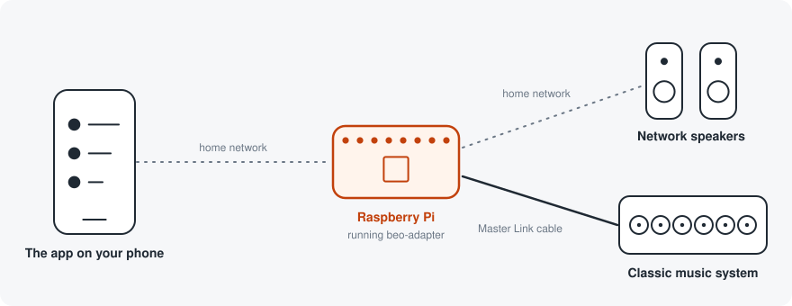
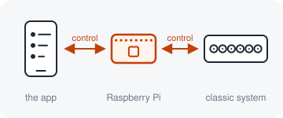
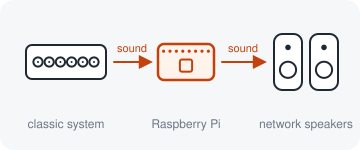
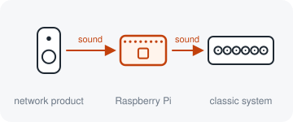
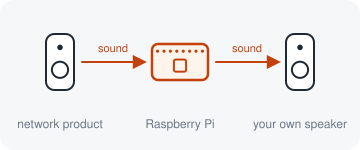

# beo

Put a classic Bang & Olufsen music system in the Bang & Olufsen app, and play
it on the speakers you bought this decade.

A Raspberry Pi sits beside the music system, on its Master Link socket. To the
app and to the other speakers in the house it is a product like any other, so
the music system is chosen, played and grouped the way they are. Nothing is
changed inside the music system.

**This project is not affiliated with, endorsed by, or supported by Bang &
Olufsen.** If you want an officially supported way to put a Master Link system
on the network, Bang & Olufsen sell an NL/ML Converter. This project is the
alternative for people who would rather build it.

## What you get

<table>
<tr>
<td width="300"></td>
<td><b>The music system in the app.</b> 
See its discs, choose one, play, pause, skip and set the volume from your
phone. The app shows what the machine is actually playing. 
<i>Works, with a BeoSound 9000.</i></td>
</tr>
<tr>
<td></td>
<td><b>Its sound in every room.</b> 
Expand the music to your network speakers from the app, as you would from any
other product. The disc plays in time with them. 
<i>Works, with a BeoSound 9000.</i></td>
</tr>
<tr>
<td></td>
<td><b>The house's music on the classic system.</b> 
What another product is playing comes out of the music system and the
speakers connected to it. 
<i>Experimental, and off until you turn it on.</i></td>
</tr>
<tr>
<td></td>
<td><b>A network speaker of your own.</b> 
With a speaker on the Pi's audio output, the Pi is a speaker other products
can play to, with or without a music system. 
<i>Experimental, and off until you turn it on.</i></td>
</tr>
</table>

**In a browser too.** The product has a page of its own at
`http://<product>.local/web/`: the same controls, and its sound played in the
browser, on a phone with the screen locked as well. *Works, with a BeoSound
9000 and on an iPhone.*

Other Master Link music systems (BeoSound 3000, 3200 and 4, BeoCenter 2) can
be chosen in the installer. They are there to be tried: none of them has been
run against the real machine.

## What you need

Always:

- a Raspberry Pi
- a phone with the Bang & Olufsen app, on the same network

And, depending on what you want from it:

- for a classic music system: a Master Link interface, which is also the
  sound card. [Getting started](docs/getting-started.md#setup-a-a-classic-music-system)
  says which one, and where it is sold
- for its sound in other rooms: Bang & Olufsen network speakers
- for a speaker of the Pi's own: a speaker with its own amplifier

You do not need to know Python. You do need to be willing to write an SD card
and type a few commands.

## Getting started

1. Connect the Pi to the music system and to your network.
2. Run the installer on the Pi and answer its questions.
3. Open the app. The music system is there to be set up.

**[docs/getting-started.md](docs/getting-started.md)** takes you through it
step by step.

## Licence and credit

Written by [Tobias Laursen](https://github.com/djerik) and released under the
[Apache License 2.0](LICENSE). Use it, change it and pass it on. What you
pass on, or build on it and publish, must carry the attribution in
[NOTICE](NOTICE) and say which files you changed.

## For developers

The rest of this page is about the code.

Beo, Master Link, NetworkLink, Beosound, Beolab, Beoplay and BeoLink are
trademarks of Bang & Olufsen, used here only to name the protocols the code
speaks. No artwork, typeface or product imagery from Bang & Olufsen is
included.

### Packages

| Distribution | Import | What it is |
|---|---|---|
| `beo-product` | `beo.product` | what a product is: identity, play state, volume. No I/O |
| `beo-masterlink` | `beo.masterlink` | the wired bus: codec, transport, roles, the music system |
| `beo-networklink` | `beo.networklink` | product to product: beocore, FPS audio, discovery, roles |
| `beo-mozart` | `beo.mozart` | what the Bang & Olufsen app talks to: api/v1, WebSocket, mDNS, product profiles |

No protocol package depends on another. Each depends on `beo.product` and
nothing else, which is what lets an application wire any two of them together.
A Music Assistant provider can take `beo-networklink` without acquiring a
serial port or an HTTP server.
[docs/architecture.md](docs/architecture.md) lists the places where the tree
still differs from the design.

The application that wires them together is [`apps/beo-adapter`](apps/beo-adapter):
the service the installer starts. It runs with a BeoSound 9000 behind it, with
one of four other music systems that are there to be tried, or
with nothing behind it as a plain speaker in the app.

These are PEP 420 native namespace packages. Every distribution that
contributes to `beo` omits `__init__.py` from the namespace directory; ship
that file in one of them and the others stop being importable.

Planned: `beo-audio`, for everything that opens a sound card. It is not a file
move. The audio code today is written against the NetworkLink datagram size,
and a local speaker needs a different block size, so the boundary cannot be
drawn before the sink is designed.

### Installing from a development machine

`python deploy/deploy.py` copies the repository to the Pi named in `BEO_PI`,
takes a backup of what is there, and runs the installer.
[docs/install.md](docs/install.md) says what the installer does.

### Documentation

- [docs/getting-started.md](docs/getting-started.md): from an empty SD card
  to a product in the app.
- [docs/install.md](docs/install.md): what the installer does, updating,
  removing, and what to check when it does not work.
- [docs/configuration.md](docs/configuration.md): every setting.
- [docs/architecture.md](docs/architecture.md): the use cases, the packages
  and why they are cut where they are.
- [docs/app-protocol.md](docs/app-protocol.md): what the Bang & Olufsen app
  requires of a Mozart product. The facade's comments point into it.
- [docs/product-matrix.md](docs/product-matrix.md): the product types the app
  can draw, how the Pi switches between them, and which have been tried.
- [docs/hardware-carrier.md](docs/hardware-carrier.md): a draft of
  purpose-built hardware.
- [packages/mozart/docs/identity.md](packages/mozart/docs/identity.md): how
  the product's serial is chosen, and why it is never random.

### Running the tests

From the repository root:

    python -m pytest

Nothing needs installing first: `pytest.ini` puts the packages on the path.
Everything runs without hardware: the bus is faked, the audio is generated,
and the product answers in process.

### What is verified

Measured against real equipment rather than inferred:

- A BeoSound 9000 appears in the app with its discs, and transport works.
- Its sound plays on NetworkLink speakers, with the timing offset measured from
  the listening speaker's own log.
- Streaming audio plays into the 9000 as a network source, with metadata on the
  machine's own display.

Built and not yet verified end to end: another product playing to this one.
The product listens, adds itself to the network's shared configuration when
told to, and plays the stream into the machine behind it. Built and not yet
run on hardware: playing it on a sound card of the product's own, with or
without a machine.

Not yet: switching a classic machine off over the bus. Each product profile
carries whether it was tested or guessed, so the distinction stays visible in
the code rather than only here.
