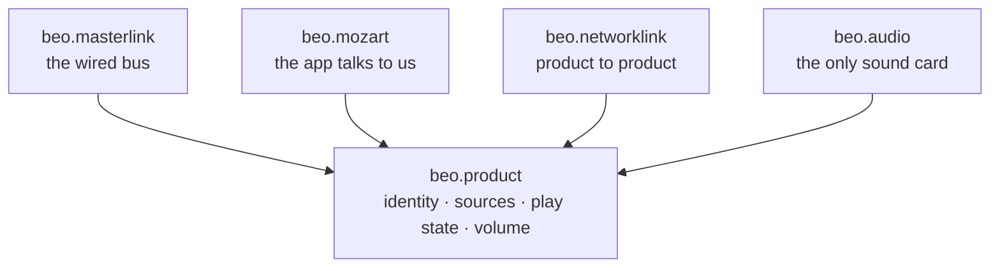

# Architecture

Three protocols, one domain. Everything below is derived from the use cases
rather than from how the code grew, and every claim about what works says
whether it was measured or assumed.

This document sits next to the code and gets corrected in the same commit as
the change that invalidated it. Sections 3 and 4 describe the design; section 5
lists where the tree still differs from it.

## 1. The use cases

Everything follows from this list, so it comes first. Status is what has
actually been run against hardware.

| | Use case | Application | Status |
|---|---|---|---|
| 1 | A BeoSound 9000 appears in the app: discs, tracks, transport | beo-adapter | verified |
| 2 | The 9000's sound plays on modern speakers over NetworkLink | beo-adapter | verified |
| 3 | Streaming audio plays *into* the 9000 as a network source | beo-adapter | verified |
| 4 | A Beo4 at the classic product drives all of it | beo-adapter | half |
| 5 | Music Assistant plays to B&O speakers directly | ma-networklink | planned |
| 6 | The Pi is itself a speaker in the app and in groups | beo-adapter | appears as a plain speaker; listens to another product when asked to, and plays the stream into the machine behind it, on a sound card output of its own, or both. With neither the stream is received and not played. Not verified end to end, and the output of its own has not been run on hardware |
| 7 | The Pi is audio master, so a classic link-room speaker plays modern sources | beo-adapter | not designed |
| 8 | Diagnostics: another product's logs, the timing offset, bus decoding | library modules: `networklink.nsdk`, `networklink.ptp`, `masterlink.codec` | in use |
| 9 | More than one classic product on the same bus | beo-adapter | not modelled |
| 10 | A B&O remote's key presses reach Home Assistant | beo-adapter | planned, after the first release |
| 11 | A browser plays the product's sound and steers it, a phone with its screen locked too | beo-adapter | verified on an iPhone, with the 9000's sound and with another product's stream passed on. A pause on a locked phone cannot be resumed there |

Home Assistant control of a classic product was on this list and was removed. It
costs nothing to support, because use case 1 already presents the machine as a
product and Home Assistant's own Bang & Olufsen integration can add it like any
other. Writing a second integration would be writing the same thing twice.

## 2. One application per bus, not per use case

Use cases 1, 2, 3, 7 and 9 collapse into one application, and not for tidiness.
The application owns the serial port exclusively. Two of them cannot sit on one
Master Link bus, so a separate program for the audio-master case could never run
next to the 9000 case, and a real bus may well have both a music system and a
link room on it.

What differs between them is the role on the bus and the product profile, which
is configuration, not a program.

Use case 6 turned out to be the same application too. A product with nothing
behind it is the product with the machine set to none: the app-facing side is
identical, and only the profile and the bus side differ. So there is one
application, `beo-adapter`, and the machine is a setting. The machine decides
the bridge and the profile together, because choosing them apart lets the app
draw six discs in front of a machine that has none.

## 3. The packages



| Package | What it is | Depends on |
|---|---|---|
| `beo.product` | identity, sources, play state, volume, the source and sink protocols. No I/O at all | nothing |
| `beo.masterlink` | codec, bus, transport, the roles, the music system, a profile per product | product |
| `beo.networklink` | beocore, FPS, PTP, discovery, the source and listener roles, the diagnostic clients | product |
| `beo.mozart` | api/v1, WebSocket, mDNS, and the product profile the app renders | product |
| `beo.audio` | the only package that opens a sound card. **Not built**, see the gaps | product |

That table is the design. Section 5 says what each package holds today.

**No package on the upper row is to depend on another.** That is what lets one
application wire any two of them together, and it is why Music Assistant can
take the NetworkLink package without acquiring a serial port, an HTTP server or
ALSA. The source and sink protocols are to live in `product` as plain types, so
the implementations stay out of every protocol package.

One namespace, shipped as PEP 420 native namespace packages: the distribution is
`beo-masterlink`, the import is `beo.masterlink`. Every distribution that
contributes to the namespace must omit `__init__.py` from the `beo/` directory,
or the others stop being importable.

The namespace only earns its keep because somebody installs a subset, and that
somebody is use case 5. Without it, one distribution with subpackages would be
the simpler answer, which is what Home Assistant does.

## 4. Why the domain package earns its place

A shared package is easy to add and hard to justify, so here is the work it
does. The adapter used to convert the machine's state into the app's state by
hand in one function, and convert it again for the BeoLink side in another. Two
hand-written translations that had to agree, with no type to agree on.

All three protocols describe the same handful of things. A product has an
identity. It has sources. One is playing or paused. There is a volume with a
maximum and a muted flag. Each appears in all three with different spelling.
Given one set of types, every protocol package maps to and from them once,
inside the package that owns its wire format.

How far that has come: identity is one type everywhere. Play state is the
domain enum on the bus side, and volume is the type the NetworkLink side
sends. The facade still keeps its state in the app's own JSON shapes, and the
application translates between the two.

Two planes, and they never meet:

- **Control** runs from the machine through `masterlink` into the shared types
  and out to `mozart` for the app and `networklink` for other products. Every
  leg runs both ways: state outwards, commands back.
- **Audio** takes its own path, in from the bus and out as a network stream, or
  the reverse. It never passes through `product`, which is why the sound card
  belongs to a package of its own and why the domain types carry no samples.

## 5. One repository

This reverses an earlier decision, so it needs a reason. The old rule was one
repository per package, because the libraries have different audiences and a
monorepo would drag a serial port into a library that only needs a socket. That
worry is about dependencies, and dependencies are declared per package, not per
repository. Packages designed together, by one person, pay the monorepo cost
once and the multi-repository cost on every change that crosses a boundary.

```
beo/
├─ packages/
│  ├─ product/        beo-product       identity, playback. Types only, no I/O
│  ├─ masterlink/     beo-masterlink    codec, bus, music_system, profiles
│  │                                    roles/     source_center
│  ├─ networklink/    beo-networklink   beocore, fps, ptp, audio, discovery, nsdk, sources,
│  │                                    configuration
│  │                                    roles/     source, listener
│  └─ mozart/         beo-mozart        facade, ws, profile
├─ apps/
│  └─ beo-adapter/    the service: main, machines, ml_bridge, classics_adapter_profile,
│                     streaming, listening, speaker, web
├─ deploy/            the installer, the updater, the systemd unit, the udev rule, deploy.py
└─ docs/              this document, the app protocol, the install guide, the product
                      matrix, the carrier-board draft
```

`packages/mozart/docs/identity.md` explains how the serial is chosen.

That is what exists. Three things in it are not where this document says they
belong, and they are listed so the tree is not mistaken for the design:

- `mozart/facade.py` still carries disc and track handling, so the package
  knows more about a disc changer than a plain speaker needs. It also knows
  its sources by name, the discs and the radio, where `masterlink` takes them
  from the machine's profile. A machine whose first source has no discs is
  therefore driven on the bus and not yet shown in the app.
- `beo.product` holds identity, play state and volume only. Sources are still
  described in `networklink/sources.py`, and the source protocol is
  `networklink.audio.AudioSource`. The sink has no protocol of its own: the
  listener role writes to whatever has a `write(block)`.
- `networklink/audio.py` opens the sound card, in through `AlsaCapture` and
  out through `AlsaPlayback`, which is the job of the package that is not
  built. See the gaps.

Planned and not built: the `link_node` and `audio_master` roles and a product
registry in `masterlink`, and `beo.audio`.

Note what `masterlink` does not have: a module per B&O product. Nine tenths of
what driving a BeoSound 9000 takes is generic bus behaviour, the operation queue
and the press-and-confirm loop, and copying that into a file per product would
be the worst possible outcome. What differs between a disc changer, a tuner and
a television is a description: which sources it offers, which keys mean
anything, and the few sequences with measured timings peculiar to it. That is a
profile, and it is data rather than code.

There is a second reason, and it matters more. Only one product can be tested
here. A folder promising a file per product invites writing one from forum posts
instead of from measurements, which is the opposite of how everything else was
established. A profile carries its own provenance, so it is visible at a glance
which products were verified on hardware and which are guesses.

## 6. Naming

- **The one name that was wrong.** The library once called `beolink` implements
  NetworkLink. BeoLink is the umbrella Bang & Olufsen have used since the 1980s
  for distributing sound around a house, and Master Link is one of the things
  underneath it. A package named after the umbrella sitting beside a package
  named after its own child is unreadable. It is `networklink`.
- **Name a package after the protocol, not the pattern.** A facade is an
  implementation detail. `mozart` is a thing you can look up: products emit
  `X-Mozart-Version` headers and Bang & Olufsen publish a repository called
  mozart-open-api, so the word is public rather than a codename we guessed.
- **Use the name on the hardware.** Someone with a product in front of them
  should recognise the package from the manual.
- **The namespace is the manufacturer's own prefix, and that is a deliberate
  trade.** Beo is what goes in front of every product they sell, so it is
  recognisable and it reads well with the module names. What it costs is any
  claim to distance from the brand, and a word that is hopeless to search for.
  It is also the cheapest decision here to reverse: changing it is a search and
  replace over import lines. The readme carries the weight instead, with a plain
  statement that the project is unaffiliated.
- **Applications say what they bridge**: the side we attach to, then the
  protocol.

## 7. What the use cases exposed

Four gaps, and three of them were in work done here rather than inherited.

**Audio comes out towards a machine, or on a card of the product's own.**
`AlsaPlayback` writes a received stream to a sound card, each block at its time
on the network's clock. The application opens the machine's card only once the
machine has taken the network source, and a card of the product's own as soon
as the stream starts; with both, one stream is written to the two. The
product's volume reaches the second card through its mixer, which the
application sets. That path is built and has not been run on hardware. Use
case 7 has nothing yet.

**Listening is off unless asked for, and so is enrolling.** `ListenerRole`
answers a source, gives it our address and hands what arrives to a sink.
`BEO_LISTEN` turns it on. A source accepts a listener only if it finds it in
the configuration its network shares; `networklink.configuration` reads that
document and adds the product's own entry when `BEO_ENROL` is set, and never
otherwise, because it changes something every product on the network holds.

**ALSA sits inside a protocol library, and moving it is not a move.** The rule
says a library never opens a sound card, and the capture and playback classes
sit in one anyway. Worse, every class in that module is written against the network
datagram: each defaults to the 44.1 kHz NetworkLink format and reads exactly one
datagram's worth of bytes per call, and the source protocol itself is defined in
those terms. A local speaker does not want a 1062-frame block, because that is a
network datagram and not a sound-card period. The sink that exists takes
network blocks too, and the product's own output uses it as it is. So `audio`
cannot be lifted out until a local speaker's sink is designed; doing it blind
would carry the network shape into the one package that must not have it.

**The bus has one product, not a system.** A Master Link bus can carry a music
system and several link rooms. The code models one product. Use case 9 needs a
registry, which is also what makes the audio-master role tractable.

## 8. Order of work

1. **Create the repository and move the two libraries in.** *Done, 2 October.*
   The existing tests passed unchanged. This is where `beolink` became
   `beo.networklink`.
2. **Extract product.** *Done, 2 October.* Identity first, because it existed in
   two places that disagreed about the host name: the library's default
   announced any product without an explicit host as a Beoplay M3, and asking
   for a host name now fails rather than guessing. Then play state, which had
   the bus's own byte values as its members and is now a domain enum with an
   explicit table in the codec, and volume, which both sides read from one type.
3. **Lift the facade into mozart.** *Done, 3 October.* It did not need the Pi.
   The facade depends on neither protocol library, so the move was mechanical;
   what was missing was any way to tell whether it had gone wrong. Sixty-three
   recorded answers and ten named invariants now stand behind it, and every
   answer was identical after the move. The Classics Adapter profile moved back
   into the application. The facade's own disc and track handling did not; see
   section 5.
4. **Find neighbours on the network.** *Done, 3 October.* The hard-coded list of
   one owner's products is gone, along with the file that overrode it. The
   application injects a directory that browses mDNS continuously, which keeps
   the app-facing protocol free of any dependency on the product-to-product one.
5. **Design the sink, then extract audio.** A first sink exists, for playing
   into a machine, and it is shaped like the network datagram. See the gaps:
   the package boundary cannot be drawn before a local speaker's sink is.
6. **Then the new roles.** The listener role is built. The audio-master role
   and the product registry for use cases 7 and 9 remain.
7. **Remote presses to Home Assistant, after the first release.** The first
   release ships without use case 10. Two ways in, and neither has been run on
   hardware. A Beo4 press at the machine is expected on the bus only while a
   network source is selected, as a key telegram addressed to that source;
   whether a machine sends it has to be measured before anything is built
   on it. A Beoremote One with Bluetooth is an ordinary HID device, so pairing
   it with the Pi gives key events without any protocol work. What is not
   decided is how the presses reach Home Assistant: as button events over the
   WebSocket its Bang & Olufsen integration already listens on, or on a
   channel of their own.

## 9. Standing on measurement, not on taste

- **Verified against the real app:** one triple, a Beolab 8 carrying the
  Classics Adapter item number. Everything about product profiles is an
  extrapolation from that single point.
- **Verified on the bus:** the 9000 answers the two network sources and reports
  a distributed source, so the adapter follows the machine instead of guessing.
- **Measured, not assumed:** the product type field has to carry a value the
  peer recognises. Making it internally consistent instead killed the connection
  outright.
- **Looked up rather than guessed:** the app does not key off the type number at
  all. It renders the product from the codename in the mDNS record, and its own
  table holds every one of them.
- **Still open:** switching a classic machine off over the bus, and why one
  listener never sends its connect message.
