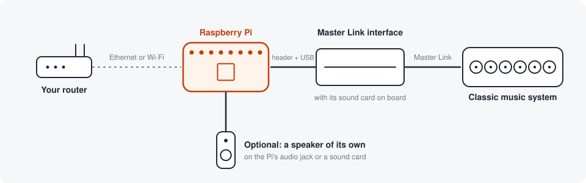

# Getting started

From an empty SD card to a product in the Bang & Olufsen app. Allow an hour.
You type a handful of commands and never open a source file.

There are two things to build. Pick one, do the basis, then follow that
setup only.

| | You get | You need besides the Pi |
|---|---|---|
| **[Setup A](#setup-a-a-classic-music-system)** | a classic music system in the app, and its sound on your network speakers | a Master Link interface and cable |
| **[Setup B](#setup-b-a-speaker-of-its-own)** | a speaker other products can play to. Experimental | a speaker with its own amplifier |

## The basis

The same for both setups.

You need a Raspberry Pi with its power supply and a microSD card, and a phone
with the Bang & Olufsen app. A Pi 3B+ is the one everything here was tried
on; newer models are expected to work.

The phone and the Pi must be on the same network, and not a guest network:
the app finds products by listening for them, and guest networks keep devices
from hearing each other.

### 1. Prepare the Pi

Write Raspberry Pi OS Lite to the SD card with
[Raspberry Pi Imager](https://www.raspberrypi.com/software/). Before it
writes, the Imager offers to change the settings. Do, and set:

- a hostname, such as `beo`
- a user name and a password
- your Wi-Fi, unless the Pi gets a network cable
- SSH: on, with password login

Put the card in the Pi. Do not give it power yet.

### 2. Connect it

What to connect is the first step of your setup, below. Do that, give the Pi
power, and wait a minute.

### 3. Log in and fetch the software

From a computer on the same network, open a terminal (on Windows:
PowerShell) and log in with the names you chose:

    ssh <user>@<hostname>.local

Then fetch the software:

    sudo apt install -y git
    git clone https://github.com/djerik/beo.git
    cd beo

Now go to your setup.

## Setup A: a classic music system

**What you need.** A Master Link interface and a Master Link cable. A
MasterDataTool v1 is the interface that has been tried. It carries the
commands between the Pi and the music system, and it is also the sound card
that takes the music system's sound in. There is no separate sound card to
buy. The v1 is no longer sold. Its successor, the
[MasterDataTool v2](https://labs.polyvection.com/mdt), is. The code speaks
to it, but it has not been tried against a machine: if you have one, expect
to be the first, and the log is where to look. To hear the music system in
other rooms you need Bang & Olufsen network speakers; controlling it from the
app needs none.

**Connect.** With the Pi off, put the interface on the Pi's pin header. A v1
also has a USB lead, which goes in one of the Pi's USB ports; a v2 has none.
Run the Master Link cable from the interface to the music system's Master
Link socket.

Nothing is changed in the music system, and the Pi never wakes it on its own.
It is switched on by you, at the machine or in the app.

**Turn on the interface's sound card.** It is one line in the Pi's start-up
file, and it takes effect when the Pi restarts. For a v1:

    CFG=/boot/firmware/config.txt; [ -f $CFG ] || CFG=/boot/config.txt
    printf '\n[all]\ndtoverlay=hifiberry-dacplusadcpro,slave\n' | sudo tee -a $CFG
    sudo reboot

A v2 has a different card, and talks to the Pi on the Pi's own UART, which
has to be turned on and taken away from Bluetooth. Three lines, then:

    CFG=/boot/firmware/config.txt; [ -f $CFG ] || CFG=/boot/config.txt
    printf '\n[all]\ndtoverlay=hifiberry-dacplusadc\nenable_uart=1\ndtoverlay=disable-bt\n' | sudo tee -a $CFG
    sudo reboot

Wait a minute, log in again and go back to the folder with `cd beo`.
`aplay -l` should now list a card called `sndrpihifiberry`. With a v2,
`ls -l /dev/serial0` should point at `ttyAMA0`.

**Install.**

    bash deploy/install.sh

It reports what it finds and asks a few questions. Each shows a suggestion in
brackets, and Enter accepts it.

| It asks | Answer |
|---|---|
| turn the jack on | Enter, for no |
| which product should the app see | Enter. `beolab-8` is the one that has been tried |
| what is behind it | Enter for a BeoSound 9000, which is the one that has been tried |
| what should this product be called in the app | anything you like |

A question that has only one possible answer on your Pi is not asked. It ends
with `Done. Open the Bang & Olufsen app on a phone on this network.`
Go to [In the app](#in-the-app).

## Setup B: a speaker of its own

Experimental. The Pi has no music system behind it. Other products in the
house can play to it, and the sound comes out of a speaker connected to the
Pi.

**What you need.** A speaker with its own amplifier and a 3.5 mm cable, for
the Pi's audio jack. A Pi 5 and a Pi Zero have no jack and need a sound card
instead.

**Connect.** The speaker to the Pi's audio jack.

**Install.**

    bash deploy/install.sh

It reports what it finds and asks a few questions. Each shows a suggestion in
brackets, and Enter accepts it.

| It asks | Answer |
|---|---|
| turn the jack on | `yes` |
| which product should the app see | Enter. `beolab-8` is the one that has been tried |
| what is behind it | Enter, for `none` |
| what should this product be called in the app | anything you like |
| a sound card that plays to a speaker directly | Enter, for the jack: `Headphones` |

It ends with `Done.` and a line saying the jack plays from the next start.
Before restarting, do the next step.

**Let other products find it.** A product plays only to the products on a
list that all your Bang & Olufsen products share. This adds the Pi to that
list. It adds one entry and changes no other, but it is a change to your
other products, which is why the installer does not do it for you:

    sudo sed -i 's/^BEO_ENROL=.*/BEO_ENROL=1/' /etc/beo/product.env
    sudo reboot

Go to [In the app](#in-the-app).

## In the app

The same for both setups.

If the app is already open, close it completely first and open it again. It
looks for new products when it starts.

The Pi appears as a new product, under the name you gave it, ready to be set
up like one out of its box. Follow the app through the setup.

**With setup A, try this:**

- Put discs in the music system and choose one in the app. The machine
  starts, and the app follows what it is playing.
- Play, pause, skip and change the volume from the app.
- Expand the music to a network speaker from the app. The disc plays in both
  rooms.
- Open `http://<product>.local/web/` and tick **Auto** by the speaker under
  *Play on other products*. From then on the speaker plays along every time
  the music system is switched on, from the app or from its own remote.

**With setup B, try this:**

- Start music on another product, and expand it to the Pi from the app.
- Change the Pi's volume in the app. The speaker follows.

## Going further: the house's music on the music system

Experimental, and an addition to setup A. What another product plays comes
out of the music system. It is off after installing, and takes two settings.
The second is the shared list described under setup B:

    sudo sed -i 's/^BEO_LISTEN=.*/BEO_LISTEN=on/; s/^BEO_ENROL=.*/BEO_ENROL=1/' /etc/beo/product.env
    sudo systemctl restart beo-adapter

Do it while nothing is playing: the restart stops the music.

## When the sound stutters on a speaker

Two commands say where a stutter comes from. On the Pi, after the speaker
has played the product for a few minutes and stopped:

    journalctl -u beo-adapter --since -15min | grep -E 'dropped|plan reset|CADENCE'

A block dropped between the sound card and a stream is a hole in that stream,
and the lines say how many and for whom. The cadence lines say how evenly the
datagrams left. Then, on the Pi, with the speaker's address:

    beo-listening 203.0.113.50

That fetches the speaker's own log and counts the holes it had to bridge, how
often it started its player over, which is what a stutter is, and how far
ahead the stream arrived. Around a thousand milliseconds is what a product's
own stream gives it. Send both outputs along when reporting a stutter.

The same command reads the rest of the speaker's log, which is where a join
or a link that went nowhere explains itself:

    beo-listening 203.0.113.50 --find 'provider|Attach|ConnectRequest|Experiences|config'

The installer puts the command in place; from a checkout elsewhere it is
`python -m beo.networklink.nsdk`, with `packages/product` and
`packages/networklink` on `PYTHONPATH`.

## Later

- **A newer version:** `bash deploy/update.sh` in the `beo` folder on the Pi.
  It refuses while something is playing, and goes back by itself if the new
  version does not start. More in [install.md](install.md#updating).
- **Removing it:** `bash deploy/install.sh --uninstall`.
- **Changing a setting:** [configuration.md](configuration.md).
- **It does not work:** [install.md](install.md#when-it-does-not-work).
